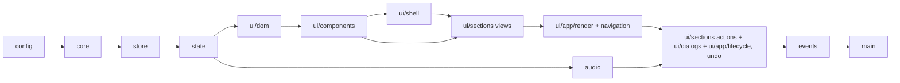

# Refactor plan: `legacy/habit_tracker_dashboard.html` → modular Vite project

Status: **draft, waiting for approval.** No code has been written.

---

## 1. What I found (facts that shape the plan)

### 1.1 Anatomy of the legacy file (7,429 lines, 461 KB)

| Lines     | Content                                                                                                 |
| --------- | ------------------------------------------------------------------------------------------------------- |
| 7–18      | Pre-paint theme script (reads `habit_tracker_prefs_he_v2`, sets `html.dark`)                            |
| 19, 25–44 | Tailwind Play CDN + inline `tailwind.config`                                                            |
| 20–23     | Google Fonts (Heebo 400/600/700)                                                                        |
| 45–375    | One `<style>` block (~330 lines): design tokens, motion, components, skeleton, reduced-motion overrides |
| 377–1135  | Static markup: header + 3 sections, bulk bar, drag tray/ghost, mobile nav, 4 modals, toast              |
| 1137–7428 | One IIFE: **~300 top-level declarations**, of which **~75 are mutable `let` / shared mutable objects**  |

### 1.2 How the Tailwind CDN actually behaves (I read its source; it serves **v3.4.17**)

The CDN script generates CSS **asynchronously**, only once `document.body` exists, and then calls
`document.head.append(style)`. Three consequences:

1. **Tailwind's CSS lands _after_ the custom `<style>` block**, so Tailwind (preflight and utilities)
   wins every specificity tie against the custom CSS. The build must reproduce this order:
   **custom CSS first, then `@tailwind base/components/utilities`.** Visible cases that depend on it:
   - `input::placeholder` — preflight's `#9ca3af` beats the custom `#5b6b82` in light mode.
   - `.drop-chip { transition … }` is overridden by `.transition` on the same element.
   - `.sheet-grabber { margin: 8px auto 0 }` is overridden by `-mt-1 mb-2` in two modals.
2. **The CDN runs autoprefixer**, so the build adds autoprefixer as well.
3. The CDN only generates classes it has seen in the DOM, and only after a short async delay. The build
   generates them all up front. That removes a brief flash of unstyled elements on the first use of a
   class. I'll record it in the notes as an intended difference.

**Version pin:** `tailwindcss@3.4.17` (exact), not 3.4.19 and not v4, which changes defaults and colours.

### 1.3 Execution timing

The legacy script is a classic script at the end of `<body>`. A `<script type="module">` (Vite, in
both dev and build) also runs after parsing and **before `DOMContentLoaded`**, so the timing is the
same. Two things still need care:

- Several things run **at script evaluation**: global listeners, `ResizeObserver` creation,
  `wireRangePreview()`, `wireToastPause()`, the initial `weekDays`, `selectedDateKey` and
  `isDarkMode`, the tooltip element, and a 60 s interval.
- **Listener registration order matters.** Example: the modal `keydown` handler (L2654) must stay
  registered before the menu-Escape handler (L5377). Otherwise one Escape press closes an open menu
  _and_ the modal under it. → Modules will have **no side effects at import time.** Each one exports a
  `wire…()` / `init…()` function, and `main.js` calls them in the legacy order (§5).

### 1.4 Dynamic Tailwind classes

No Tailwind class name is assembled from fragments (no `bg-${x}`). The only built name is
`seg-pill--${…}`, which is custom CSS. Every class in JS template strings, `classList` calls and
`COLOR_OPTIONS` is a complete literal token, so `content: ['./index.html', './src/**/*.js']` finds
them all. I'll still add a **safelist generated from `COLOR_OPTIONS`**, with `tailwind.config.js`
importing `src/config/colors.js` as the single source of truth. An **automated coverage check**
(§7.4) will prove no class is lost.

### 1.5 Dead code (behaviour-neutral; I'll remove it and record it in the notes)

- `SCHEDULE_FIELDS` is never read.
- `focusOrderCache` is written in `switchMainSection` and never read.
- `.ring-progress` CSS is never used in the markup or JS.
- Unused locals: `streak`, `weeklyPct`, `isWeeklyQuotaMet` and `goalLabel` in the focus card, and
  `colorMeta` in the leaderboard. The values are pure or memoized, so removing them has no observable
  effect.
- `HEBREW_MONTHS_SHORT` is identical to `HEBREW_MONTHS`. I'll keep both names, but one will become an
  alias of the other.

---

## 2. Target structure

```
index.html                 markup byte-identical to legacy <body>; inline pre-paint theme script;
                           inline skeleton critical CSS; <link> to src/styles/main.css; module entry
src/
  main.js                  bootstrapping only: wire listeners in legacy order, DOMContentLoaded boot
  config/                  pure data, imports nothing
    storage-keys.js  categories.js  icons.js  colors.js  hebrew.js  schedule.js  analytics.js
  core/                    pure logic: no DOM, no window, no Store (lint-enforced)
    dates.js  time.js  schedule.js  habit.js  stats.js  overlaps.js
    analytics-range.js  format.js  sort.js  text.js
  store/                   data owner + everything cached on Store.revision
    storage.js  sanitize.js  store.js  sample-habits.js  selectors.js
  state/                   UI state that used to be loose `let`s (sealed objects, §4)
    app.js  tracker.js  analytics.js  manage.js  categories.js  calendar.js
    habit-form.js  motion.js  undo.js  prefs.js
  audio/
    feedback.js
  ui/
    dom/          html.js  icons.js  patch.js  animate.js  flip.js
    components/   modal.js  toast.js  tooltip.js  menus.js  segmented.js  reveal.js
                  scroll-fades.js  custom-select.js
    shell/        theme.js  sound.js  greeting.js
    app/          render.js  navigation.js  lifecycle.js  undo.js  form-controls.js
    sections/
      category-filter-bar.js  filters.js
      tracker/    view-mode.js  date-strip.js  summary.js  visible-habits.js  habit-card.js
                  focus-view.js  week-view.js  habits-list.js  actions.js
      analytics/  filter.js  range-controls.js  bar-chart.js  line-chart.js  habit-grid.js
                  legend.js  analytics.js  leaderboard.js  actions.js
      manage/     manage-grid.js  archive.js  bulk-bar.js  drag-drop.js  actions.js
    dialogs/
      confirm.js
      category-manager/  render.js  actions.js
      calendar/          render.js  calendar.js  date-input.js
      habit-form/        category-select.js  sections.js  start-date.js  time-model.js
                         summaries.js  schedule-scope.js  form-controller.js  time-editor.js
                         goal-type.js  appearance.js  habit-form.js
  events/         modal-closers.js  click-actions.js  form-actions.js  delegation.js
                  global-listeners.js
  styles/         main.css  tokens.css  base.css  components.css  animations.css
                  reduced-motion.css  overrides.css
tests/
  harness/        legacy.js (loads the original), modern.js, fake-clock.js, fixtures/, generators.js
  unit/core/…  unit/store/…        mirror src/core and src/store
  parity/         logic.parity.test.js   (legacy vs modern pure functions, randomized)
                  dom.parity.test.js     (legacy vs modern app, scripted interactions, in jsdom)
e2e/              smoke.spec.js  visual-parity.spec.js (Playwright)
scripts/          check-tailwind-classes.mjs
legacy/           the original file, kept as the parity reference
```

Roughly 75 modules, most of them 50–250 lines.

### Changes from the suggested architecture, and why

- **`store/selectors.js`.** The suggestion puts caches in `core/`, but `getDayStats`, `memoForHabit`,
  `calculateStreak`, `calculateBestStreak`, `getHabitRangeProgress`, `getOverlapIndex` and
  `findTimeOverlaps` are invalidated by `Store.revision` or per-habit revisions. In `core/` they would
  break the `core → store` direction. So `core/` keeps the pure `compute…` functions, and the
  revision-keyed caches go next to the Store. Date caches (`dayNum` maps, `todayCache`,
  `dayObjCache`) depend only on the clock, so they stay in `core/dates.js`.
- **`ui/dialogs/`.** The habit form, category manager, confirm dialog and full calendar are feature
  dialogs, not reusable widgets. `ui/components/` keeps only the generic pieces.
- **Calendar in `dialogs/calendar/`.** It is both the tracker's date navigator and the date/range
  picker for forms. In navigation mode it closes itself and switches section
  (`selectDateFromCalendar`), so it can't be a leaf component.
- **Drag & drop in `sections/manage/`.** It is specific to habit cards and the category tray, not a
  generic component.
- **`ui/app/`.** Section orchestration (`renderAll`, `renderSection`, `switchMainSection`), boot
  (`loadState`), day rollover and undo. `main.js` stays bootstrapping only.

---

## 3. Map: every legacy declaration → target module

Legacy line numbers are in parentheses. "(L…)" ranges are inline listener blocks.

### config/ (pure constants)

| Module            | Legacy                                                                                                                                          |
| ----------------- | ----------------------------------------------------------------------------------------------------------------------------------------------- |
| `storage-keys.js` | `STORAGE_KEY` (1142), `CATEGORIES_STORAGE_KEY` (1143), `PREFS_STORAGE_KEY` (1144), `LEGACY_HABITS_KEY` (2057, was inside Store)                 |
| `categories.js`   | `DEFAULT_CATEGORIES` (1145), `UNCATEGORIZED_LABEL` (2420)                                                                                       |
| `icons.js`        | `ICON_OPTIONS` (1147), `MORE_ICONS` (6287)                                                                                                      |
| `colors.js`       | `COLOR_OPTIONS` (1165), `COLOR_MIGRATION` (1174), `getColorMeta` (2872)                                                                         |
| `hebrew.js`       | `HEBREW_DAYS_SHORT` (1189), `HEBREW_DAYS_FULL` (1190), `HEBREW_MONTHS` (1191), `HEBREW_MONTHS_FULL` (1192), `HEBREW_MONTHS_SHORT` (7166, alias) |
| `schedule.js`     | `MAX_SLOTS` (1498), `TIME_RE` (1499), `DAY_PARTS` (1743)                                                                                        |
| `analytics.js`    | `ANALYTICS_PRESETS` (3567), `MAX_RANGE_DAYS` (3574)                                                                                             |
| removed           | `SCHEDULE_FIELDS` (1497, unused)                                                                                                                |

### core/ (pure, DOM-free)

| Module               | Legacy                                                                                                                                                                                                                                                                                                                                                                                                                                                                                                                                 |
| -------------------- | -------------------------------------------------------------------------------------------------------------------------------------------------------------------------------------------------------------------------------------------------------------------------------------------------------------------------------------------------------------------------------------------------------------------------------------------------------------------------------------------------------------------------------------- |
| `dates.js`           | `formatDateKey` (1269), `DAY_MS` (1280), `keyToDayNum` (1281), `dayNumToKey` (1282), `dayNumOf` (1284), `keyOfDayNum` (1293), `dowOfDayNum` (1304), `dowOfKey` (1305), `todayCache` (1308), `todayDayNum` (1309), `getDateKeyDaysAgo` (1321), `dayObjCache` (1327), `dayObjCacheToday` (1328), `dayObjForKey` (1329), `getWindow7Days` (1354), `isFutureDateKey` (1487), `isValidDateKey` (1838), `parseDateKeyLocal` (3578), `addDaysToKey` (3582), `daysBetweenKeys` (3586), `buildDaysForRange` (3696), `splitDaysIntoWeeks` (3814) |
| `time.js`            | `timeToMinutes` (1718), `minutesToTime` (1722), `formatTimeRange` (1727), `timeRangeText` (1732), `timeBlock` (1739), `dayPartOf` (1748)                                                                                                                                                                                                                                                                                                                                                                                               |
| `schedule.js`        | `normalizeScheduleFields` (1502), `pickScheduleFields` (1565), `sameScheduleFields` (1577), `normalizeHabitSchedule` (1588), `baseHabit` (1660), `getScheduleVersion` (1665), `habitOn` (1679), `isHabitScheduledForDayOfWeek` (1696), `isHabitScheduledOnKey` (1708), `isFlexibleOnKey` (1713), `scheduleWeekdays` (1753), `dayTimesRow` (1758), `hasAnyTime` (1767), `slotCount` (1774), `timesOnDay` (1796), `isHabitScheduledForDateKey` (1832), `applyScheduleEdit` (6183, called by the Store)                                   |
| `habit.js`           | `normalizeHabitGoal` (1628), `isSlotDone` (1781), `hasAnyMarkOnDay` (1789), `getEarliestCheckedKey` (1842), `inferHabitStartDate` (1850), `isHabitArchived` (1863), `isHabitActiveOnKey` (1873), `isHabitActiveInDays` (1882), `getHabitCategoryDisplay` (2426)                                                                                                                                                                                                                                                                        |
| `stats.js`           | `computeDayStats` (2859), `computeStreak` (2788), `getFlexibleStreakInWeeks` (2742), `computeBestStreak` (3915), `computeHabitRangeProgress` (3835), `getWeeklyGoalForHabit` (1889), `getWeeklyCountForHabit` (2837) ¹                                                                                                                                                                                                                                                                                                                 |
| `overlaps.js`        | pure core of `getOverlapIndex` (6045) and `findTimeOverlaps` (6065): `buildOverlapEntries(liveHabits)`, `findOverlaps(entries, def, excludeId)`                                                                                                                                                                                                                                                                                                                                                                                        |
| `analytics-range.js` | `getPresetRange` (3590), `getPreviousRangeBounds` (3896) ², `formatRangeLabel` (3765) ²                                                                                                                                                                                                                                                                                                                                                                                                                                                |
| `format.js`          | `getGreetingByHour` (1205), `formatDaySet` (1801), `scheduleTimeSummary` (1814), `formatStartDateLabel` (1916), `getHabitGoalLabel` (1923), `getHabitGoalTypeLabel` (1930), `getHabitStreakUnit` (2821), `formatWeekRangeText` (3404), `isoNum` (3763), `habitCountLabel` (5440), `describeScheduleVersion` (6129), `formatDateTriggerLabel` (7156), `formatDateCompactLabel` (7167)                                                                                                                                                   |
| `sort.js`            | `nameCollator` (2423), `compareByName` (2424)                                                                                                                                                                                                                                                                                                                                                                                                                                                                                          |
| `text.js`            | `getGraphemes` (6289)                                                                                                                                                                                                                                                                                                                                                                                                                                                                                                                  |

¹ The legacy `days = weekDays` default reads UI state. In core, `days` becomes an explicit argument, and
the tracker call sites pass `tracker.weekDays`. Same value, so the behaviour is unchanged.
² These read `analyticsRangeState`. In core they take the range as an argument.

### store/

| Module             | Legacy                                                                                                                                                                                                                                                                                                                                                                  |
| ------------------ | ----------------------------------------------------------------------------------------------------------------------------------------------------------------------------------------------------------------------------------------------------------------------------------------------------------------------------------------------------------------------- |
| `storage.js`       | Store internals `isQuotaError`, `read`, `readJson`, `write`, `lastWritten` (2072–2097)                                                                                                                                                                                                                                                                                  |
| `sanitize.js`      | `ID_RE`, `ICON_UNSAFE_RE`, `sanitizeIcon`, `sanitizeHistory`, `sanitizeHabit`, `sanitizeCategories` (2058–2141)                                                                                                                                                                                                                                                         |
| `store.js`         | `Store` (2055) with the same public API: private `habits`, `categories`, `revision`, `revCounter`, `habitRevs`, `habitJson`, `liveCache`, `prefsProvider`, `onPersistError`, `applyInvariants`, `persist`, `commit`, `find`                                                                                                                                             |
| `sample-habits.js` | `getDefaultHabits` (1382)                                                                                                                                                                                                                                                                                                                                               |
| `selectors.js`     | `getLiveHabits` (1867), `habitMemo` (2765), `memoForHabit` (2766), `calculateStreak` (2782), `getHabitStreakText` (2825), `getHabitStreakLongText` (2831), `dayStatsCache` (2844), `getDayStats` (2845), `getHabitRangeProgress` (3828), `calculateBestStreak` (3909), `overlapIndex` (6044), `getOverlapIndex` (6045), `overlapMemo` (6064), `findTimeOverlaps` (6065) |

### state/ (formerly loose `let`s; see §4 for the API)

| Module          | Legacy variable → property                                                                                                                                                                                                                                                                                                                                                                    |
| --------------- | --------------------------------------------------------------------------------------------------------------------------------------------------------------------------------------------------------------------------------------------------------------------------------------------------------------------------------------------------------------------------------------------- |
| `app.js`        | `soundEnabled` (1194), `isDarkMode` (1196), `themeChosenByUser` (1197), `currentMainSection` (1200)                                                                                                                                                                                                                                                                                           |
| `tracker.js`    | `weekOffset` (1199), `weekDays` (1362), `selectedDateKey` (1363), `lastKnownTodayKey` (1364), `currentViewMode` → `viewMode` (1365), `trackerSelectedCategory` → `selectedCategory` (1366), `unscheduledSectionExpanded` → `restGroupExpanded` (1368)                                                                                                                                         |
| `manage.js`     | `manageSelectedCategory` → `selectedCategory` (1367), `manageSelectMode` → `selectMode` (5381), `selectedHabitIds` (5382), `manageVisibleHabitIds` → `visibleHabitIds` (5383), `suppressNextCardClick` (5386), `habitDragState` → `drag` (5387), `archiveSectionExpanded` → `archiveExpanded` (6650)                                                                                          |
| `categories.js` | `editingCategoryName` → `editingName` (1380), `categorySelectMode` → `selectMode` (5384), `selectedCategories` → `selected` (5385)                                                                                                                                                                                                                                                            |
| `calendar.js`   | `calendarViewYear` (1201), `calendarViewMonth` (1202), `calendarViewMode` (1203), `calendarPicker` → `picker` (3014)                                                                                                                                                                                                                                                                          |
| `analytics.js`  | `analyticsRangeState` → `range` (3575), `analyticsFilter` → `filter` (3958), `restoreAnalyticsRange` (3607), `ensureAnalyticsRange` (3619)                                                                                                                                                                                                                                                    |
| `habit-form.js` | `selectedModalIcon` (1376), `selectedModalColor` (1377), `selectedModalGoalType` (1378), `selectedModalFixedDays` (1379), `habitModalInitialState` (5813), `timeModel` (5834), `scheduleScope` (6127)                                                                                                                                                                                         |
| `motion.js`     | `lastToggledHabitId` (1370), `lastToggle` (1372), `celebrateDayKey` (1373), `pendingWeekSlide` (2949), `pendingCalSlide` (2950), `analyticsEntryAnim` (3997), `flashHabitIds` (4764), `lastSelectToggledId` (5389), `selectModeJustChanged` (5390), `justPicked` (6434), `renderingEntry` (6912); animation memory `prevRingPct` (1374), `prevBarHeights` (3998), `prevLeaderboardPct` (3999) |
| `undo.js`       | `lastActionUndoSnapshot` (1375), `createUndoSnapshot` (2431)                                                                                                                                                                                                                                                                                                                                  |
| `prefs.js`      | `currentPrefs` (2364), `savePrefs` (2375)                                                                                                                                                                                                                                                                                                                                                     |
| removed         | `focusOrderCache` (1369, write-only)                                                                                                                                                                                                                                                                                                                                                          |

### audio/

| Module        | Legacy                                                                        |
| ------------- | ----------------------------------------------------------------------------- |
| `feedback.js` | `audioCtx` (1198, private), `suspendAudio` (1215), `playFeedbackSound` (1219) |

### ui/dom/

| Module       | Legacy                                                                                                                                                |
| ------------ | ----------------------------------------------------------------------------------------------------------------------------------------------------- |
| `html.js`    | `escapeHtml` (6896), `timeRangeHtml` (1735)                                                                                                           |
| `icons.js`   | `ICON_PATHS` (1177), `icon` (1185), `CHEVRON_SVG` (6979), `CALENDAR_SVG` (6980)                                                                       |
| `patch.js`   | `patchTemplate` (3714), `sameAttributes` (3716), `morphChildren` (3725), `FOCUS_KEY_ATTRS` (3745), `focusSignature` (3746), `patchHTML` (3751)        |
| `animate.js` | `prefersReducedMotion` (2591), `RESTARTABLE_ANIMATIONS` (2953), `restartAnimationClasses` (2954), `restartAnimationClass` (2963), `shakeField` (6435) |
| `flip.js`    | `EASE_OUT_JS` (4715), `captureFlip` (4716), `playFlip` (4724), `withFlip` (4739), `animateOut` (4745), `flashHabits` (4758), `flashClassFor` (4765)   |

### ui/components/

| Module             | Legacy                                                                                                                                                                                                                                                                                                                                                                                                     |
| ------------------ | ---------------------------------------------------------------------------------------------------------------------------------------------------------------------------------------------------------------------------------------------------------------------------------------------------------------------------------------------------------------------------------------------------------- |
| `modal.js`         | `openModalStack` (2590), `FOCUSABLE` (2592), `getVisibleFocusables` (2594), `showModal` (2598), `hideModal` (2615), `nudgeModal` (2638), plus a `topModal()` accessor for the keyboard handler                                                                                                                                                                                                             |
| `toast.js`         | `toastTimer`, `toastEndsAt`, `toastRemaining` (6796–6798, private), `TOAST_HIDDEN`, `TOAST_SHOWN`, `hideToast` (6802), `scheduleToastHide` (6811), `showToast` (6817), `pauseToast` (6854), `resumeToast` (6863), `wireToastPause` (6870)                                                                                                                                                                  |
| `tooltip.js`       | `setupTooltips` (4648) → `initTooltips()`                                                                                                                                                                                                                                                                                                                                                                  |
| `menus.js`         | `closeAllMenus` (5349), `toggleMenu` (5363), document listeners (L5376–5377) → `wireMenus()`                                                                                                                                                                                                                                                                                                               |
| `segmented.js`     | `updateSegPills` (1981), `updateSegPill` (2020), `segResizeObserver` (2025), DOMContentLoaded init (L2028) → `initSegPills()`                                                                                                                                                                                                                                                                              |
| `reveal.js`        | `setRevealOpen` (4618)                                                                                                                                                                                                                                                                                                                                                                                     |
| `scroll-fades.js`  | `updateScrollFades` (6964), `scrollFadesFrame` (6970), `scheduleScrollFades` (6971)                                                                                                                                                                                                                                                                                                                        |
| `custom-select.js` | `openSelectState` (6981, private, with an `isCustomSelectOpen()` accessor), `watchValue` (6983), `fireChange` (6993), `relabel` (6998), `enhanceSelect` (7002), `openCustomSelect` (7040), `renderSelectPanel` (7060), `positionSelectPanel` (7085), `chooseSelectOption` (7110), `closeCustomSelect` (7118), `handleSelectPanelKeys` (7134), dismiss listeners (L7151–7154) → `wireCustomSelectDismiss()` |

### ui/shell/, ui/app/

| Module                 | Legacy                                                                                                                           |
| ---------------------- | -------------------------------------------------------------------------------------------------------------------------------- |
| `shell/theme.js`       | `systemDarkQuery` (1195), `applyThemeUI` (1941), `toggleTheme` (6878), system-theme listener (L6884) → `wireSystemTheme()`       |
| `shell/sound.js`       | `applySoundUI` (1960), `toggleSound` (6890)                                                                                      |
| `shell/greeting.js`    | `renderGreeting` (6930)                                                                                                          |
| `app/render.js`        | `staleSections` (6909), `SECTION_RENDERERS` (6913), `renderSection` (6936), `prerenderHiddenSections` (6949), `renderAll` (6956) |
| `app/navigation.js`    | `switchMainSection` (2876)                                                                                                       |
| `app/lifecycle.js`     | `handlePersistError` (2381), `loadState` (2387), `checkDayRollover` (2451), skeleton `waitForStyles` (L7414–7425)                |
| `app/undo.js`          | `triggerToastUndo` (2438)                                                                                                        |
| `app/form-controls.js` | `enhanceFormControls` (7217)                                                                                                     |

### ui/sections/

| Module                        | Legacy                                                                                                                                                                                                                                                                                                                                                                                                                                                |
| ----------------------------- | ----------------------------------------------------------------------------------------------------------------------------------------------------------------------------------------------------------------------------------------------------------------------------------------------------------------------------------------------------------------------------------------------------------------------------------------------------- |
| `category-filter-bar.js`      | `renderCategoryFilterBar` (4552), shared by tracker and manage                                                                                                                                                                                                                                                                                                                                                                                        |
| `filters.js`                  | `setCategoryFilter` (3418)                                                                                                                                                                                                                                                                                                                                                                                                                            |
| `tracker/view-mode.js`        | `applyViewModeButtonsUI` (2034)                                                                                                                                                                                                                                                                                                                                                                                                                       |
| `tracker/date-strip.js`       | `renderHeaderDateStrip` (3436)                                                                                                                                                                                                                                                                                                                                                                                                                        |
| `tracker/summary.js`          | `renderTrackerSummary` (3502)                                                                                                                                                                                                                                                                                                                                                                                                                         |
| `tracker/visible-habits.js`   | `getTrackerVisibleHabits` (5731)                                                                                                                                                                                                                                                                                                                                                                                                                      |
| `tracker/habit-card.js`       | `timeChipsHtml` (4768), `buildHabitFocusCardHtml` (4780)                                                                                                                                                                                                                                                                                                                                                                                              |
| `tracker/habits-list.js`      | `renderHabitsList` (4873): filtering, empty states, dispatch                                                                                                                                                                                                                                                                                                                                                                                          |
| `tracker/focus-view.js`       | focus branch of `renderHabitsList` (4922–5064) → `renderFocusView(container, filtered)`                                                                                                                                                                                                                                                                                                                                                               |
| `tracker/week-view.js`        | weekly-matrix branch (5065–5226) → `renderWeekView(container, filtered)`                                                                                                                                                                                                                                                                                                                                                                              |
| `tracker/actions.js`          | `selectDay` (2927), `setViewMode` (2941), `shiftWeek` (2967), `jumpToToday` (2978), `toggleUnscheduledGroup` (4640), `toggleHabitDay` (5739), `markAllForSelectedDay` (5779), `clearAllForSelectedDay` (5799)                                                                                                                                                                                                                                         |
| `analytics/filter.js`         | `getAnalyticsFilterInfo` (3960), `renderAnalyticsFilterSelect` (3981)                                                                                                                                                                                                                                                                                                                                                                                 |
| `analytics/range-controls.js` | `getAnalyticsDays` (3704), `renderAnalyticsRangeControls` (3783)                                                                                                                                                                                                                                                                                                                                                                                      |
| `analytics/bar-chart.js`      | `barFrom` (4244), `barGrowClass` (4247), `barGrowStyle` (4251), `renderBarChart` (4258), `avgLineFrame` (4319), `schedulePositionAvgLine` (4320), `positionAvgLine` (4325)                                                                                                                                                                                                                                                                            |
| `analytics/line-chart.js`     | `renderLineChart` (4343)                                                                                                                                                                                                                                                                                                                                                                                                                              |
| `analytics/habit-grid.js`     | `renderHabitGrid` (4199)                                                                                                                                                                                                                                                                                                                                                                                                                              |
| `analytics/legend.js`         | `renderChartLegend` (4431)                                                                                                                                                                                                                                                                                                                                                                                                                            |
| `analytics/analytics.js`      | `KPI_IDS` (4000), `renderAnalytics` (4002)                                                                                                                                                                                                                                                                                                                                                                                                            |
| `analytics/leaderboard.js`    | `widenFrom` (4479) with its `.cache`, `renderLeaderboard` (4492)                                                                                                                                                                                                                                                                                                                                                                                      |
| `analytics/actions.js`        | `setAnalyticsPreset` (3625), `applyCustomAnalyticsRange` (3641), `openAnalyticsRangePicker` (3659), `shiftAnalyticsRange` (3675), `setAnalyticsFilter` (3973)                                                                                                                                                                                                                                                                                         |
| `manage/manage-grid.js`       | `renderManageSection` (5229)                                                                                                                                                                                                                                                                                                                                                                                                                          |
| `manage/archive.js`           | `renderArchiveSection` (6686)                                                                                                                                                                                                                                                                                                                                                                                                                         |
| `manage/bulk-bar.js`          | `updateManageBulkBar` (5421)                                                                                                                                                                                                                                                                                                                                                                                                                          |
| `manage/drag-drop.js`         | `renderDropTray` (5504), `setDropTarget` (5519), `moveGhost` (5528), `startHabitDrag` (5533), `endHabitDrag` (5555), `onDragPointerMove`…`onDragKeydown` (5585–5615), `DRAG_LISTENERS` (5617), `dragListenersAttached` (5627), `attachDragListeners` (5628), `detachDragListeners` (5633), pointerdown listener (L5639) → `wireHabitDrag()`, `dragFrame` (5654), `dragPoint` (5655), `scheduleDragPosition` (5656), `updateDragPosition` (5665)       |
| `manage/actions.js`           | `handleManageCardClick` (5391), `toggleManageSelectMode` (5403), `exitManageSelectMode` (5408), `toggleSelectAllManageHabits` (5414), `archiveHabitsByIds` (5444), `archiveHabitsByIdsNow` (5448), `bulkArchiveSelectedHabits` (5458), `bulkDeleteSelectedHabits` (5463), `moveHabitsToCategory` (5486), `promptDeleteHabitById` (6623), `archiveHabitById` (6654), `restoreHabitById` (6667), `toggleArchiveSection` (6679), `openResetModal` (6745) |

### ui/dialogs/

| Module                          | Legacy                                                                                                                                                                                                                                                                                                                                                                                               |
| ------------------------------- | ---------------------------------------------------------------------------------------------------------------------------------------------------------------------------------------------------------------------------------------------------------------------------------------------------------------------------------------------------------------------------------------------------- |
| `confirm.js`                    | `openConfirmModal` (6762), `closeConfirmModal` (6781), `confirmHandlers` (6786, private), `runConfirm` (6787)                                                                                                                                                                                                                                                                                        |
| `category-manager/render.js`    | `buildCategoryItemRowHtml` (2689), `renderCategoryManagerItems` (2730), `updateCategorySelectUi` (5672)                                                                                                                                                                                                                                                                                              |
| `category-manager/actions.js`   | `addCategory` (2479), `handleModalAddCategory` (2498), `startCategoryRename` (2509), `cancelCategoryRename` (2522), `saveCategoryRename` (2528), `promptDeleteCategory` (2561), `openCategoryManagerModal` (2673), `closeCategoryManagerModal` (2681), `toggleCategorySelectMode` (5691), `toggleCategorySelected` (5698), `toggleSelectAllCategories` (5703), `bulkDeleteSelectedCategories` (5709) |
| `calendar/render.js`            | `calendarChromeDefaults` (3015), `calendarMaxKey` (3017), `calendarMinKey` (3020), `isCalendarKeyAllowed` (3023), `applyCalendarModeChrome` (3028), `paintRangePreview` (3080), `isCalendarViewAtCurrentMonth` (3133), `renderCalendarYearView` (3183), `renderFullCalendarGrid` (3291)                                                                                                              |
| `calendar/calendar.js`          | `openFullCalendarModal` (2987), `closeFullCalendarModal` (3004), `openDatePicker` (3055), `openRangePicker` (3068), `wireRangePreview` (3093), `handleCalendarDayClick` (3105), `shiftCalendarMonth` (3140), `toggleCalendarYearView` (3160), `openCalendarMonthFromYear` (3176), `jumpCalendarToCurrentMonth` (3262), `selectDateFromCalendar` (3270)                                               |
| `calendar/date-input.js`        | `enhanceDateInput` (7174)                                                                                                                                                                                                                                                                                                                                                                            |
| `habit-form/category-select.js` | `populateCategorySelectDropdown` (2463)                                                                                                                                                                                                                                                                                                                                                              |
| `habit-form/sections.js`        | `HABIT_SECTIONS` (6378), `toggleHabitSection` (6384)                                                                                                                                                                                                                                                                                                                                                 |
| `habit-form/start-date.js`      | `getMaxStartDateKey` (6526), `setupStartDateInput` (6532), `readStartDateInput` (6548)                                                                                                                                                                                                                                                                                                               |
| `habit-form/time-model.js`      | `isPerDayTimesOn` (5841), `modalSlotCount` (5845), `modalActiveWeekdays` (5849), `timeModelRow` (5853), `readModalTime` (5857), `loadEditorFromCell` (5867), `focusAfterRender` (5890), `setSelectDisabled` (5943), `ensureSelectOption` (5951), `timeChipHtml` (5981), `getModalScheduleDef` (6093)                                                                                                 |
| `habit-form/summaries.js`       | `updateHabitTimeHint` (6103), `updateHabitModalSummaries` (6401)                                                                                                                                                                                                                                                                                                                                     |
| `habit-form/schedule-scope.js`  | `setScheduleScope` (6136), `updateScheduleScopeBox` (6141)                                                                                                                                                                                                                                                                                                                                           |
| `habit-form/form-controller.js` | `getHabitFormState` (5815), `togglePerDayTimes` (5910), `syncHabitTimeFields` (5990), `isHabitFormSaveable` (6197), `updateHabitSaveState` (6218) ³                                                                                                                                                                                                                                                  |
| `habit-form/time-editor.js`     | `onTimeEditorChange` (5883), `pickTimeDay` (5895), `pickTimeSlot` (5902), `setModalTimesPerDay` (5925), `copyDayTimesToAll` (5936), `setModalTime` (5961)                                                                                                                                                                                                                                            |
| `habit-form/goal-type.js`       | `setModalGoalType` (6225), `toggleModalFixedDay` (6246), `renderFixedDaysPicker` (6265)                                                                                                                                                                                                                                                                                                              |
| `habit-form/appearance.js`      | `toggleCustomIconPanel` (6298), `handleCustomIconInput` (6311), `renderModalPickers` (6323), `updateHabitPreview` (6367), `selectModalIcon` (6449), `selectModalColor` (6457)                                                                                                                                                                                                                        |
| `habit-form/habit-form.js`      | `handleHabitFormEnter` (6206), `openHabitModal` (6465), `closeHabitModal` (6555), `saveHabitForm` (6559)                                                                                                                                                                                                                                                                                             |

³ `syncHabitTimeFields` → `togglePerDayTimes` → `updateHabitSaveState` → `syncHabitTimeFields` is
real mutual recursion (the "only one active day while per-day times are on" path). The three
functions stay in one module so there is no import cycle.

### events/ and main.js

| Module                       | Legacy                                                                                                                                                                                                                                                                                 |
| ---------------------------- | -------------------------------------------------------------------------------------------------------------------------------------------------------------------------------------------------------------------------------------------------------------------------------------- |
| `events/modal-closers.js`    | `MODAL_CLOSERS` (2647), used by both the keyboard handler and `backdropClose`                                                                                                                                                                                                          |
| `events/click-actions.js`    | `slotOf` (7239), `ClickActions` (7241)                                                                                                                                                                                                                                                 |
| `events/form-actions.js`     | `ChangeActions` (7313), `InputActions` (7323), `KeyActions` (7328), `SubmitActions` (7341)                                                                                                                                                                                             |
| `events/delegation.js`       | `runAlongPath` (7348), body listeners (L7358–7382) → `wireDelegatedEvents()`                                                                                                                                                                                                           |
| `events/global-listeners.js` | modal Escape/Tab keydown (L2654) → `wireModalKeyboard()`; window resize with `resizeFrame` and `lineChartResizeTimer` (L4462–4477) → `wireResize()`; minute refresh interval (L7385) → `startMinuteRefresh()`; visibilitychange and rollover interval (L7405–7412) → `wireLifecycle()` |
| `main.js`                    | wiring in legacy order plus the DOMContentLoaded boot (L7395–7426)                                                                                                                                                                                                                     |

### Styles (the 330-line `<style>`)

| Target                     | Legacy lines                                                                                                                                                                                                                              |
| -------------------------- | ----------------------------------------------------------------------------------------------------------------------------------------------------------------------------------------------------------------------------------------- |
| **inline in `index.html`** | skeleton 307–321 and the reduced-motion rule `#appSkeleton .sk { animation: none }` (359)                                                                                                                                                 |
| `tokens.css`               | `:root` motion tokens (131–138)                                                                                                                                                                                                           |
| `base.css`                 | 46–118: reset tweaks, html/body, headings, dark surfaces, sheet grabber, `.tap-44`, placeholder, date input, themed scroll, no-scrollbar, scroll fade                                                                                     |
| `components.css`           | buttons and focus (144–158), nudge (160–165), menus (167–177), modals (179–195), segmented pill (197–210), reveal (258–266), calendar range (275–279), drag & drop (281–287), form feedback (289–293), tooltip (295–305), toast (330–336) |
| `animations.css`           | pop (119–126), view fade (140–142), nav bounce (212–214), check-off (216–234), ring (236–246), directional slides (248–256), charts (268–273), flash (323–328)                                                                            |
| `reduced-motion.css`       | 338–366, which must come after everything above                                                                                                                                                                                           |
| `overrides.css`            | 367–374 (`.bar-fill`, drag card), which **must stay after reduced-motion** (see bug B1)                                                                                                                                                   |
| `main.css`                 | imports the files above in that order, **then** `@tailwind base; @tailwind components; @tailwind utilities;` (§1.2)                                                                                                                       |

Each block keeps its internal rule order. I checked every pair of custom rules that can match the same
element and property (modal open/closing/sheet, menu open/closing, tooltip below/visible, the
reduced-motion overrides): none of them crosses a file boundary in the wrong direction. Computed-style
parity (§7.3) will confirm it.

---

## 4. State: explicit modules instead of loose `let`s

Imported bindings in ES modules are read-only, so shared mutable state has to live in objects. Each
`state/*.js` exports **one sealed object** (`Object.seal`). In strict mode a misspelled property then
throws instead of silently creating a new one. Transitions that must stay consistent get **named
setters**:

```js
// src/state/tracker.js
export const tracker = Object.seal({
  weekOffset: 0,
  weekDays: getWindow7Days(0),
  selectedDateKey: getDateKeyDaysAgo(0),
  lastKnownTodayKey: getDateKeyDaysAgo(0),
  viewMode: 'focus',
  selectedCategory: 'הכל',
  restGroupExpanded: false
});
/** weekOffset and weekDays always change together. */
export function setWeekOffset(offset) {
  tracker.weekOffset = offset;
  tracker.weekDays = getWindow7Days(offset);
}
```

Rules:

- **One owner per value.** Nothing is copied between modules.
- State that only one module touches stays **private in that module**: toast timers, `audioCtx`, the
  modal stack, `openSelectState`, animation-frame handles and drag frames. Encapsulation beats a
  global bag. Where another module needs to read it, I expose a read-only accessor
  (`isCustomSelectOpen()`, `topModal()`).
- **Motion hints keep their exact set → render → reset order**, inside the same functions as in the
  legacy. For example, `toggleHabitDay` sets `motion.lastToggledHabitId`, `motion.lastToggle` and
  `motion.celebrateDayKey`, then calls `renderAll()`, then resets all three. The same holds for
  `selectModalIcon` / `selectModalColor` / `toggleModalFixedDay` (`justPicked`),
  `toggleManageSelectMode` (`selectModeJustChanged`), `handleManageCardClick`
  (`lastSelectToggledId`), the four analytics actions that set `analyticsEntryAnim` (it is reset
  inside `renderLeaderboard`), `renderSection` (`renderingEntry` with `try/finally`),
  `flashHabits` (reset on `setTimeout 0`), and `pendingWeekSlide` / `pendingCalSlide` (consumed by the
  next strip or calendar render).
- **Cache invalidation is moved verbatim:** `Store.revision`, per-habit `habitRevision` together with
  `todayDayNum()` and object identity in `memoForHabit`, `dayObjCacheToday`, `todayCache` bounds,
  `liveCache`, the `overlapIndex` revision, and the `overlapMemo` key.

---

## 5. Global side effects, in legacy order (wired by `main.js`)

1. `initSegPills()`: ResizeObserver plus a `document` DOMContentLoaded listener (L2025–2032)
2. `wireModalKeyboard()`: `document` keydown Escape/Tab (L2654)
3. `wireRangePreview()`: `#fullCalendarGrid` mouseover, focusin, mouseleave (L3093)
4. `wireResize()`: `window` resize (L4464)
5. `initTooltips()`: tooltip element, `document` DOMContentLoaded append, pointerover, pointerout,
   pointerdown, and `window` scroll (capture) (L4648)
6. `wireMenus()`: `document` click → `closeAllMenus`, and `document` keydown Escape (L5376–5377)
7. `wireHabitDrag()`: `document` pointerdown (L5639)
8. `wireToastPause()`: toast mouseenter, mouseleave, focusin, focusout (L6870)
9. `wireSystemTheme()`: `prefers-color-scheme` change (L6884)
10. `wireCustomSelectDismiss()`: `document` click and scroll (capture) (L7151–7154)
11. `wireDelegatedEvents()`: `body` click, change, input, submit, keydown (L7358–7382)
12. `startMinuteRefresh()`: `setInterval` 60 s (L7385)
13. `window` DOMContentLoaded → `enhanceFormControls()` → `loadState()` →
    `switchMainSection(current)` → `prerenderHiddenSections()` → `.scroll-fade-x` scroll listeners →
    `visibilitychange` → `setInterval(checkDayRollover, 60 s)` → skeleton fade (L7395–7426)

`enhanceFormControls()` stays before `loadState()`, so `watchValue`'s `.value` overrides exist before
any value is written.

---

## 6. Dependency graph

Arrows mean "may be imported by". Nothing points backwards.



Inside `ui/`, the rule that prevents cycles: **renderers ("views") never import `ui/app/*`,
`ui/dialogs/*` or any `actions.js`.** Actions may import views and `render.js`, but views never call
actions. I checked each legacy render function, and all of them follow this already (the only real
recursion, in the habit form, is kept in one module, see ³).

Enforcement:

- ESLint `import-x/no-restricted-paths` encodes the layer rules and the view → action ban.
- ESLint `no-restricted-globals` in `src/core/**` and `src/config/**` bans `document`, `window`,
  `localStorage`, `navigator`, `matchMedia` and `requestAnimationFrame`.
- `madge --circular src` runs in `npm run check:deps`, and `import-x/no-cycle` runs in lint.

---

## 7. Tooling and verification

### 7.1 Stack (current versions, checked on npm today)

vite 8.3 · **tailwindcss 3.4.17 (exact)** · postcss 8.5 · autoprefixer 10.6 · vitest 5.0 · jsdom 30 ·
eslint 10, `@eslint/js`, eslint-plugin-import-x 4.17, globals · prettier 3.9 with
eslint-config-prettier · madge 8 · `@playwright/test` 1.64 with pixelmatch. I'll check compatibility
when installing and pick the nearest working versions if needed.

- `tailwind.config.js` ports the inline config exactly: `darkMode: 'class'`,
  `future.hoverOnlyWhenSupported`, Heebo sans, `fontSize.xs` 13px/18px, default transition duration
  and easing. It adds `content` globs and a safelist built from `COLOR_OPTIONS`.
- `index.html` is in `.prettierignore`. Whitespace between inline elements is significant, so the
  markup stays byte-identical to the legacy `<body>`, and a test enforces that.
- Prettier settings match the legacy style (4 spaces, single quotes, wide lines) to keep diffs small.
  `.editorconfig` sets UTF-8 and LF.
- Scripts: `dev`, `build`, `preview`, `lint`, `format`, `test`, `test:e2e`, `check:css`,
  `check:deps`, and `verify` (all of them).

### 7.2 Characterization and parity tests (Vitest)

- **Legacy harness:** the harness reads `legacy/habit_tracker_dashboard.html`, puts its `<body>` into
  a fresh jsdom window and evaluates the original script with one appended line that exposes its
  internals (`globalThis.__legacy__ = { … }`). The legacy file on disk is never modified. A fake clock
  (`@sinonjs/fake-timers`) and `TZ=Asia/Jerusalem` keep runs deterministic, DST edges included.
- **Unit tests (`tests/unit/**`)** use explicit expected values, so they read as a spec. Every suite
  runs against `[legacy, modern]` from day one:
  - dates: day numbers, week windows, DST weeks, the today cache across midnight
  - schedule: normalization of every legacy shape (no `goalType`; `fixedDays` only; `slotTimes`;
    `dayTimes`; bad times; duration without a time), version sort/merge/dedupe, `habitOn`,
    `applyScheduleEdit` (forward or all)
  - stats: day stats, weekly goal (mid-week start, archive, multi-version), current and best streaks
    (daily or flexible, pauses, rest days, today not yet done), range progress (in-progress weeks)
  - store: loading damaged data (non-array JSON, bad entries skipped one by one, duplicate or invalid
    ids, unsafe icons, bad history keys, reserved category names), the legacy key fallback, old colour
    migration, future marks stripped on load, quota and unavailable write errors, invariants
    (alphabetical order, missing categories added), per-habit revisions
- **Logic parity:** a seeded generator produces about 1,000 random habits, damaged ones included,
  plus dates. Every pure function and Store operation is run on legacy and modern, and the results must
  be deep-equal.
- **DOM parity:** legacy and modern (an IIFE bundle of `src/main.js`) run in two isolated jsdom
  windows with the same clock and the same localStorage. A scripted scenario of about 60 interactions
  covers every section, modal, toast/undo, drag & drop, the calendar picker, the time editor, archive
  and restore, category rename/delete, and rollover. After each step the test compares `body`
  (whitespace-only text runs normalized, which is how CSS renders them) **and** localStorage. One
  scenario starts from **data written by the original app** and another from old-format and damaged
  fixtures.

### 7.3 Browser parity (Playwright)

- The **original** (file:// with the CDN, which needs internet) and the **new production build**
  (`vite preview`) start with the same localStorage fixture and the same fixed clock.
- Per state (3 sections, grid view, 30-day line chart, single-habit grid, select mode, archive open,
  habit form, categories, calendar month and year, confirm), in light and dark, at 1280 px and 390 px:
  1. a screenshot diff (pixelmatch, animations disabled, after `document.fonts.ready`)
  2. a **computed-style diff** of every element, including `::placeholder`. This is what proves the
     CSS cascade port.
- A smoke spec runs the main flows against the build: check a habit, undo, add or edit a habit,
  switch sections, the analytics presets and theme toggle, with no console errors.

### 7.4 Tailwind class coverage

`scripts/check-tailwind-classes.mjs` compiles Tailwind with the project config twice: once with the
legacy file as content and once with the project content. It fails if any selector from the first is
missing in the second. It runs in `npm run verify` and in tests.

---

## 8. Steps and commits

Every step must pass `build`, `lint`, `test` (unit and parity) and a manual check in the browser
before it is committed. **Code is moved by a script that copies line ranges** and then edited by hand
for imports and state access. Nothing is retyped, so Hebrew strings, emoji ZWJ sequences and the
`⁦…⁩` isolates stay byte-identical.

| #   | Commit                                                            | Content                                                                                                                                                                                                                                                                          |
| --- | ----------------------------------------------------------------- | -------------------------------------------------------------------------------------------------------------------------------------------------------------------------------------------------------------------------------------------------------------------------------- |
| 0   | `chore: add original single-file app`                             | `legacy/` as-is (baseline)                                                                                                                                                                                                                                                       |
| 1   | `build: scaffold Vite, Tailwind 3.4.17, ESLint, Prettier, Vitest` | `index.html` (markup verbatim, inline theme script and skeleton CSS), CSS split, the **whole legacy script moved unchanged into one module**. The app runs on the new stack before any logic moves, which isolates the CSS and Tailwind risk. Includes the class-coverage check. |
| 2   | `test: legacy harness and characterization tests`                 | harness, unit suites (legacy only), fixtures                                                                                                                                                                                                                                     |
| 3   | `test: logic and DOM parity harness`                              | legacy vs current module, scenario runner                                                                                                                                                                                                                                        |
| 4   | `refactor: extract config/`                                       |                                                                                                                                                                                                                                                                                  |
| 5   | `refactor: extract core/dates, time, sort, text`                  |                                                                                                                                                                                                                                                                                  |
| 6   | `refactor: extract core/schedule and core/habit`                  |                                                                                                                                                                                                                                                                                  |
| 7   | `refactor: extract core/stats, overlaps, analytics-range, format` |                                                                                                                                                                                                                                                                                  |
| 8   | `refactor: extract store/`                                        | storage, sanitize, store, sample data, selectors                                                                                                                                                                                                                                 |
| 9   | `refactor: move loose state into state/`                          | loose `let`s → sealed state objects; motion hints                                                                                                                                                                                                                                |
| 10  | `refactor: extract ui/dom and ui/components`                      |                                                                                                                                                                                                                                                                                  |
| 11  | `refactor: extract dialogs`                                       | confirm, category manager, calendar, habit form                                                                                                                                                                                                                                  |
| 12  | `refactor: extract tracker, analytics and manage sections`        |                                                                                                                                                                                                                                                                                  |
| 13  | `refactor: extract events/ and main.js; remove the monolith`      |                                                                                                                                                                                                                                                                                  |
| 14  | `test: Playwright smoke and visual/computed-style parity`         |                                                                                                                                                                                                                                                                                  |
| 15  | `docs: README and REFACTOR_NOTES`                                 | final `verify` run                                                                                                                                                                                                                                                               |

---

## 9. Risks and mitigations

| Risk                                                          | Mitigation                                                                                                                                                                                           |
| ------------------------------------------------------------- | ---------------------------------------------------------------------------------------------------------------------------------------------------------------------------------------------------- |
| CSS cascade differs (CDN appends Tailwind _after_ custom CSS) | Custom CSS first in `main.css`, then the Tailwind directives; computed-style diff per state, light and dark                                                                                          |
| Tailwind or autoprefixer output drift                         | Pin 3.4.17; add autoprefixer; the computed-style diff catches prefix-only differences (the CDN ships 2024 caniuse data, so a few `-webkit-` prefixes may differ; any such difference will be listed) |
| Vite 8 CSS minifier merges or rewrites rules                  | The parity runs use the **production** build                                                                                                                                                         |
| A class missing from the build                                | Content globs, safelist from `COLOR_OPTIONS`, the coverage script                                                                                                                                    |
| Listener or init order changes                                | No import-time side effects; explicit wiring in legacy order (§5)                                                                                                                                    |
| A leftover bare reference to an old `let`                     | ESLint `no-undef` and `no-shadow`; sealed objects throw on typos; DOM parity                                                                                                                         |
| Motion-hint timing                                            | Kept inside the same functions with the same set/render/reset order; ring/bar/KPI animation classes are part of the DOM compared after each step                                                     |
| Cache invalidation                                            | Code moved verbatim; logic parity on revision bumps and day changes                                                                                                                                  |
| `watchValue` `.value` override                                | Same code; `enhanceFormControls()` still runs before `loadState()`; DOM parity covers select labels                                                                                                  |
| Byte-exact strings (Hebrew, emoji, bidi isolates)             | Scripted line-range moves; no retyping; `index.html` excluded from Prettier                                                                                                                          |
| De-indenting code changes whitespace inside template literals | It only changes whitespace-only runs in text nodes, which render identically; the DOM diff normalizes exactly that and nothing else                                                                  |
| Import cycles                                                 | View/action split; `import-x/no-cycle`; `madge --circular`                                                                                                                                           |
| **localStorage is per-origin**                                | See question 1 below. The key/format compatibility is guaranteed by tests, but data is only _visible_ if the new app runs at the same origin as the old file.                                        |
| `file://` can't load module scripts                           | Same question: optional single-file build                                                                                                                                                            |

---

## 10. Bugs and inconsistencies noticed (not fixed; they will go into `REFACTOR_NOTES.md`)

- **B1** Reduced motion doesn't stop bar transitions. `@media (prefers-reduced-motion)` sets
  `.bar-fill { transition: none }`, but the unconditional `.bar-fill { transition: … }` comes later
  with the same specificity and wins.
- **B2** The custom placeholder colour (`#5b6b82`, commented "4.9:1") never applies in light mode,
  because Tailwind's preflight is injected after it and wins.
- **B3** `.drop-chip`'s own transition is overridden by the `.transition` utility on the same element.
- **B4** Category counts and filtering disagree for categories with surrounding spaces.
  `getHabitCategoryDisplay` trims, but the counts (filter badges, category manager) compare
  `h.category === cat` untrimmed, and `applyInvariants` adds the _trimmed_ name to the list.
- **B5** A flexible habit's week streak breaks on weeks spent archived (paused), while a daily
  habit's streak skips paused days.
- **B6** The current streak is capped at 365 days, but the best streak looks back 730 days, so a very
  long streak can show "record: N" larger than the current streak while both describe the same run.
- **B7** After midnight, `checkDayRollover` re-renders but doesn't recompute analytics preset ranges
  ("השבוע", "7 ימים") until a reload.
- **B8** A stored colour id that isn't in `COLOR_OPTIONS` renders as indigo, but the habit form shows
  no colour selected, and saving keeps the unknown id.
- Dead code is listed in §1.5.

---

## 11. Decisions I need from you

1. **Where does the original run today?** As a file opened from disk, or at a URL? localStorage is
   per-origin, so existing data appears only if the new app is served from the **same URL**. Modules
   also can't load from `file://`. If you open it from disk, I'll add `npm run build:single`: one
   self-contained `index.html` you put at the old file's path. _(Recommended if you use it from disk.)_
2. **State API:** sealed state objects with named setters (§4, recommended), or one getter/setter
   function per variable (about 60 pairs, more boilerplate and no extra safety)?
3. **Git:** the baseline commit of `legacy/` goes on `master`, and the step commits on a new branch
   `refactor/modular`, so `master` keeps the original. OK?
4. **Playwright:** OK to add it? It downloads Chromium (about 150 MB), and the visual parity run needs
   internet because the original loads the Tailwind CDN and Google Fonts.
5. **Dead code (§1.5):** OK to remove it? It has no observable effect, and each removal will be
   listed in the notes.
